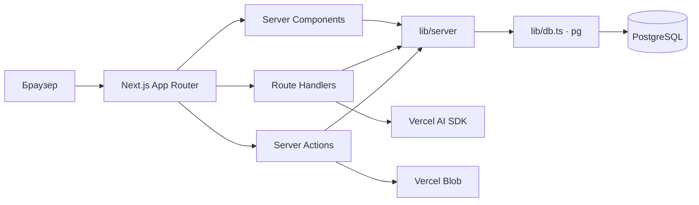

# Архитектура Canfly

Проверенный код: [`a2dd068e00cb54f9dcd2a40b75ba04f7a420e65b`](https://github.com/adiom/canfly/tree/a2dd068e00cb54f9dcd2a40b75ba04f7a420e65b). **Факт** означает проверку по этому коду; **схема** — структуру тестовой Neon `test-canfly/neondb`, скопированную без production-данных; **гипотеза** требует проверки; **план** не описывает реализованное поведение. Исторические SQL-файлы не образуют надёжной линейной истории production.

Для новой функции агенту стоит прочитать эту страницу, нужный раздел ниже, [карту потоков](flows.md), [известные разрывы](analytics.md) и затем перейти по ссылкам в код. Уточняйте актуальный SHA: документация описывает указанный выше снимок.

| Область | Страница |
| --- | --- |
| Релизы, издания, главы | [content.md](content.md) |
| Пользователи, авторизация | [identity.md](identity.md) |
| Персонажи, чаты | [characters.md](characters.md) |
| Игры | [games.md](games.md) |
| Studio | [studio.md](studio.md) |
| Чтение, статистика, пробелы | [analytics.md](analytics.md) |
| MCP | [mcp.md](mcp.md) |
| Карта модулей, API, SQL | [flows.md](flows.md) |
| Решения | [ADR](adr/README.md) |

Ключевые каталоги: [`app/`](../../app/), [`components/`](../../components/), [`lib/server/`](../../lib/server/), [`lib/actions/`](../../lib/actions/), [`lib/schemas/`](../../lib/schemas/), [`postgres/`](../../postgres/). API описан также в [docs/API.md](../API.md), MCP — в [docs/MCP.md](../MCP.md); эти файлы сверяйте с кодом перед использованием.

## Обновление

При изменении маршрута, API, SQL, доступа или события обновите соответствующий раздел и `flows.md`, проверьте ссылки, укажите SHA проверенного кода и пометьте неподтверждённое как гипотезу. Новое устойчивое решение фиксируйте отдельным ADR со статусом `proposed` либо `accepted`. Для заметного изменения продукта добавьте запись в [`docs/UPDATES.md`](../UPDATES.md). В PR перечислите затронутые разделы и источник проверки схемы. Для MCP и DeepWiki используйте эти Markdown-файлы напрямую; конфигурация экспорта, индексатор и сервер пока не предусмотрены. Не помещайте в документы секреты и данные пользователей.
