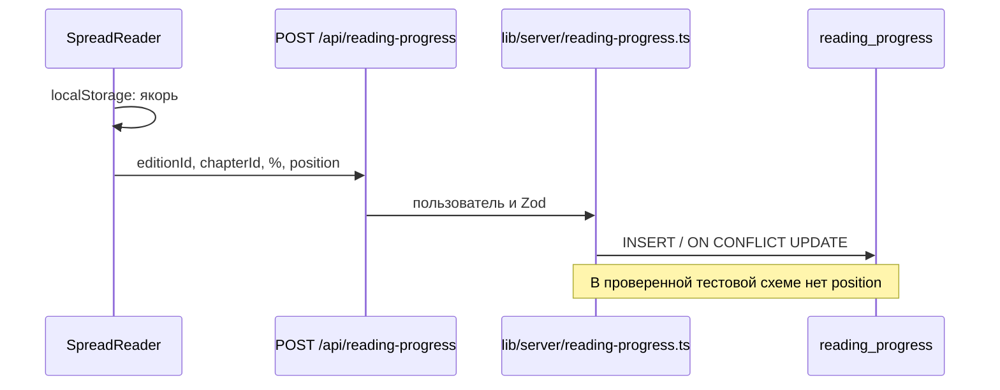

# Чтение и аналитика

Код проверен по [коммиту](README.md) от 10.11.2026; структура тестовой Neon проверялась 06.11.2026, повторно не читалась. Подробный исходный аудит: [docs/ARCHITECTURE.md](../ARCHITECTURE.md).

| Событие | Состояние |
| --- | --- |
| Перелистывание книги/журнала авторизованным пользователем | **Факт:** `SpreadReader` вызывает [`POST /api/reading-progress`](../../app/api/reading-progress/route.ts); [`upsertReadingProgress`](../../lib/server/reading-progress.ts) обновляет процент и `last_read_at` по главе. |
| Точная позиция между устройствами | **Факт по тестовой схеме:** колонки `reading_progress.position` нет; сервер пропускает её, клиент хранит якорь в `localStorage`. Состояние production требует отдельной проверки. |
| Комикс, аудио, artwork и гость | **Факт по коду:** в этих ветках ридера прогресс в БД не записывается. |
| Открытие релиза или главы | **Факт по коду:** нет вызова инкремента `releases.view_count`; [`incrementChapterViews`](../../lib/server/chapters.ts) не вызывается. Поля существуют в проверенной схеме. |
| «Читает сейчас» | **Факт:** [`fetchShelf`](../../lib/server/user-profile.ts) показывает до шести изданий из `reading_progress`, по одной последней строке на издание; это не журнал всех открытий. |
| Статистика Studio | **Факт:** [`app/studio/page.tsx`](../../app/studio/page.tsx) суммирует `releases.view_count`, не вычисляет реальные открытия. |

Приоритеты: **P0** определить и подключить учёт просмотров; **P0** согласовать и применить схему точной позиции; **P1** проверять `response.ok` при сохранении; **P1** определить прогресс для остальных форматов; **P2** отдельно решить, нужна ли история событий или библиотека. Это **план**, не действующее поведение. Не вводить новые метрики без определения события, субъекта, дедупликации и правил приватности.

## Новые события вне чтения

**Факт по коду:** [Game API](games.md) пишет `game_user_events` и `game_user_scores`; это игровые результаты и события, а не просмотры литературного контента. AI-центр агрегирует состояния и usage из `character_messages.metadata` через [character-ai-stats.ts](../../lib/server/character-ai-stats.ts). Отсутствие usage не превращается в оценку цены: стоимость не вычисляется. Состояния попыток перезаписываются в metadata вопроса, поэтому это не полный неизменяемый журнал всех повторов. `pending_now` в текущем SQL ограничен возрастом сообщения 120 секунд; это отдельное определение от deadline попытки в runtime.
