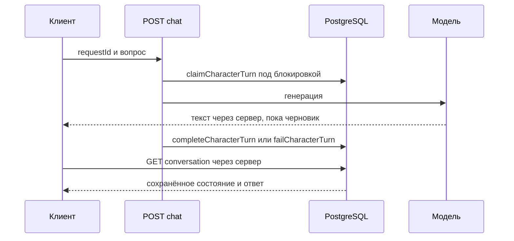

# Персонажи и чаты

Проверено по [коммиту](README.md). Каталог и профиль: [`app/characters/`](../../app/characters/); чат: [`app/characters/[slug]/chat/page.tsx`](../../app/characters/[slug]/chat/page.tsx) и [`components/character-chat.tsx`](../../components/character-chat.tsx).

| Поток | API / модуль | Таблицы |
| --- | --- | --- |
| Профиль и связи | [`lib/server/characters.ts`](../../lib/server/characters.ts), [`lib/server/character-relationships.ts`](../../lib/server/character-relationships.ts) | `characters`, `character_relationships`, `release_characters` |
| Подписка/дружба | [`api/characters/[slug]/friendship`](../../app/api/characters/[slug]/friendship/route.ts), [`lib/server/users.ts`](../../lib/server/users.ts) | `character_friendships` |
| История чата | [`api/characters/[slug]/conversation`](../../app/api/characters/[slug]/conversation/route.ts), `users.ts` | `character_conversations`, `character_messages` |
| Генерация ответа | [`api/characters/chat`](../../app/api/characters/chat/route.ts) | `character_messages`, `characters` |
| Стена и посты | [`api/characters/[slug]/wall`](../../app/api/characters/[slug]/wall/route.ts), [`lib/server/character-wall.ts`](../../lib/server/character-wall.ts) | `character_wall_posts`, `character_posts` |

## Ход чата

**Факт по коду:** [POST чата](../../app/api/characters/chat/route.ts) проверяет тело, сессию, доступность персонажа, технические настройки и канон. `claimCharacterTurn` в [users.ts](../../lib/server/users.ts) резервирует ход в транзакции под блокировкой разговора; `completeCharacterTurn` сохраняет ответ и состояние попытки. Идентификаторы и статусы хранятся в `character_messages.metadata`, отдельной таблицы ходов нет. Без уникального индекса requestId код не обещает строгий exactly-once.

[generate.ts](../../lib/ai/character-chat/generate.ts) наблюдает полный AI-поток, обрабатывает ошибку/таймаут/пустой ответ и ожидает сохранение. Клиентские [character-chat-client.ts](../../lib/chat/character-chat-client.ts) и [character-chat-state.ts](../../lib/chat/character-chat-state.ts) считают поток черновиком до GET `/api/characters/[slug]/conversation?requestId=...`. Завершённый ответ воспроизводится без новой генерации; `pending/unknown` блокируют повтор; подтверждённый неуспешный ход требует явного retry с идентификатором попытки. Остановка получения потока на устройстве сама по себе не доказывает отмену на сервере.

GET истории — только чтение. Удаление заблокированной дружбы пользователем не позволяет обойти блокировку. Публичные данные формируются через [character-public.ts](../../lib/character-public.ts).

## Настройки и канон

[character-ai-settings.ts](../../lib/server/character-ai-settings.ts) — общий resolver для Studio и runtime; при отсутствии таблицы применяются defaults. Авторская инструкция остаётся в `characters.system_role`, технические настройки отделены. См. [Studio](studio.md).

[Манифест](../../lib/ai/character-chat/canon/manifest.ts), [отбор](../../lib/ai/character-chat/canon/selection.ts) и [gate](../../lib/ai/character-chat/canon/gate.ts) разрешают только утверждённые фрагменты опубликованных глав, связанные с персонажем и прошедшие проверку хешей и границы знаний. Активный манифест без пригодных источников даёт `503 canon_unavailable` до резервирования хода. **Факт:** единственный манифест Сони остаётся `draft`; механизм подготовлен, но этот канон не активирован. Не следует считать наличие `is_primary` утверждением канона.

**Ограничение проверки:** новые unit/E2E существуют в репозитории, но в этом документационном обновлении не запускались; надёжность на реальном провайдере и БД не проверена.
