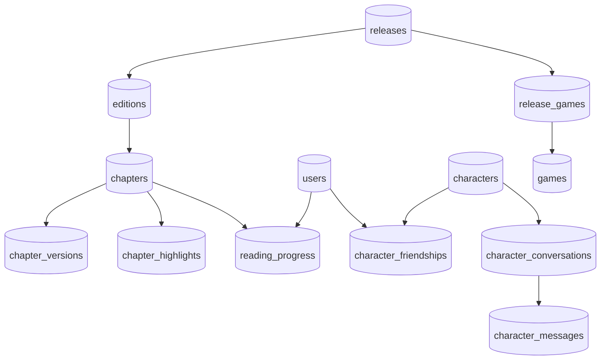

# Потоки данных и карта модулей

Проверено по [коммиту](README.md). Таблица показывает главные зависимости; для конкретной функции переходите в исходник. SQL-запросы находятся преимущественно в `lib/server/*`; [`lib/db.ts`](../../lib/db.ts) — общий доступ через `pg`.

| Страница / функция | UI | API / Action | SQL-модуль | PostgreSQL |
| --- | --- | --- | --- | --- |
| `/releases`, `/release/[slug]` | страницы `app/` | чтение Server Component | `releases.ts`, `editions.ts` | `releases`, `editions`, связи |
| `/vvvvv/[slug]` | `SpreadReader`, comic/audio/artwork | `POST /api/reading-progress` для книги/журнала | `reading-progress.ts`, `chapters.ts` | `reading_progress`, `chapters` |
| `/user`, `/user/[slug]` | `ReadingShelf` | чтение Server Component | `user-profile.ts`, `users.ts` | `users`, `reading_progress`, `chapter_highlights` |
| `/studio/*` | редакторы `components/studio/` | `lib/actions/studio*.ts` | `releases.ts`, `editions.ts`, `chapters.ts` и предметные модули | контент и связи |
| `/characters/*` | `CharacterChat`, профиль | `/api/characters/*` | `characters.ts`, `users.ts`, `character-wall.ts` | `characters`, `character_messages`, дружба, посты |
| `/games/*` | `GameEmbed`, game.html, CanflyGame | `GET/POST /api/games/[slug]/progress` | `games.ts`; SQL прогресса находится прямо в Route Handler | `games`, `release_games`, `character_games`, `game_user_scores`, `game_user_events` |
| `/studio/ai/*` | AI-центр | `studio-character-ai.ts` | `character-ai-settings.ts`, `character-ai-stats.ts` | `character_ai_settings`, `character_messages`, `character_conversations` |
| `/v2` | сцены `components/v2` | Server Component | `v2.ts` и репозитории контента | релизы, издания, персонажи, серии, места |
| `/api/mcp` | MCP client | `app/api/mcp/route.ts`, OAuth handlers | `lib/mcp/tools/*`, `mcp-oauth.ts` | контент и `mcp_oauth_*` |

Диаграмма показывает предметные связи, а не полный набор FK. Фактические ограничения проверяйте по целевой схеме БД. `proxy.ts` также обрабатывает старые `/books`, `/shop`, `/cart`, `/reader`, `/scroll`; обработчики `/api/books` и `/api/orders` возвращают ответы о выводе из эксплуатации.

Новые таблицы в этой карте — требования к схеме из кода и миграций, а не подтверждение их наличия в production. Существующий Game API размещает SQL непосредственно в Route Handler; не следует описывать доступ через репозиторий как универсально соблюдённое правило.
