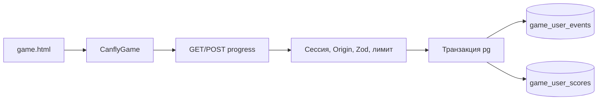

# Игры

Проверено по [коммиту](README.md). **Факт:** [`/games`](../../app/games/page.tsx) показывает каталог, [`/games/[slug]`](../../app/games/[slug]/page.tsx) загружает опубликованную игру и связи, [`GameEmbed`](../../components/game-embed.tsx) встраивает статический контент из [`public/games/`](../../public/games/). Запросы и связи — в [`lib/server/games.ts`](../../lib/server/games.ts); таблицы `games`, `release_games`, `character_games`. Редактирование — [`app/studio/games/`](../../app/studio/games/) и [`lib/actions/studio-games.ts`](../../lib/actions/studio-games.ts).

## Game API v0.1

**Факт по коду:** стандартный runtime — `/games/<slug>/game.html`; [GameEmbed](../../components/game-embed.tsx) и заголовки [next.config.mjs](../../next.config.mjs) используют эту точку входа. Общий SDK [canfly-game-api.js](../../public/games/canfly-game-api.js) предоставляет `CanflyGame.load()` и `save()`.

[GET/POST /api/games/[slug]/progress](../../app/api/games/[slug]/progress/route.ts) проверяет пользователя и опубликованность игры. POST требует same-origin Origin и JSON, валидирует payload и лимитирует запросы. В транзакции создаётся `game_user_events`, а при наличии score обновляется `game_user_scores` с last/best score. Уникальная тройка game/user/requestId исключает повторную запись одного запроса; GET возвращает результат и до 20 событий. Это клиентские очки, сервер не подтверждает прохождение игры и не предотвращает подделку результата авторизованным клиентом.

Таблицы объявлены в [035_game_user_progress.sql](../../postgres/035_game_user_progress.sql). **Применение к БД не проверено.** Предыдущий вывод об отсутствии игрового сохранения устарел. «Рогатка» [q/game.html](../../public/games/q/game.html) подключает аккаунтные результаты и восстановление после offline-сбоя; это не означает одинакового покрытия всех игр.

SEO-поля `seo_title`, `seo_description`, `seo_noindex` добавлены в Studio и [034_games_seo.sql](../../postgres/034_games_seo.sql); sitemap исключает noindex-игры. Подробный контракт — [public/games/README.md](../../public/games/README.md).
