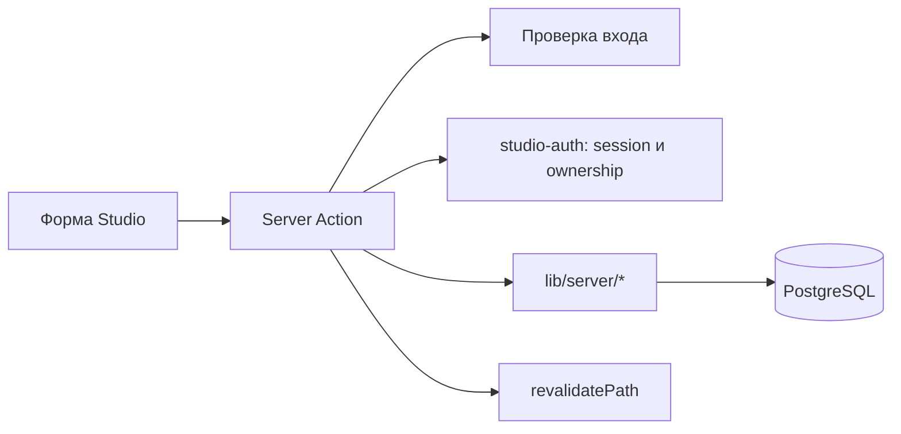

# Studio

Проверено по [коммиту](README.md). **Факт:** [`app/studio/layout.tsx`](../../app/studio/layout.tsx) проверяет сессию и строит общий UI. Страницы в [`app/studio/`](../../app/studio/) управляют релизами, изданиями, главами, персонажами, сериями, местами, играми и новостями. Мутации проходят через [`lib/actions/studio.ts`](../../lib/actions/studio.ts) и соседние `studio-*` actions; они используют схемы [`lib/schemas/`](../../lib/schemas/) и репозитории [`lib/server/`](../../lib/server/).

**Факт:** [`/studio`](../../app/studio/page.tsx) получает релизы через `getMyReleasesWithEditions`; администратор видит все, остальные — свои. Его число «Просмотров» суммирует `releases.view_count`. Причина недостоверности текущего значения описана в [analytics.md](analytics.md). Для доступа к релизу/изданию/главе применяются `require*Ownership()` из [`studio-auth.ts`](../../lib/server/studio-auth.ts). **План:** при расширении Studio сохранять проверку в каждой мутации; одного `proxy.ts` недостаточно.

## AI-центр

**Факт:** [список `/studio/ai`](../../app/studio/ai/page.tsx) и [карточка `/studio/ai/[id]`](../../app/studio/ai/[id]/page.tsx) используют [studio-character-ai.ts](../../lib/actions/studio-character-ai.ts), [character-ai-settings.ts](../../lib/server/character-ai-settings.ts) и [character-ai-stats.ts](../../lib/server/character-ai-stats.ts). Агрегаты доступны author/admin, изменение технических параметров — только admin; правила в [access.ts](../../lib/ai/character-chat/access.ts). Панель не открывает тексты чужих переписок.

Таблица `character_ai_settings` объявлена в [033_character_ai_settings.sql](../../postgres/033_character_ai_settings.sql): модель, temperature, output, timeout, лимиты и revision. Наличие миграции не подтверждает её применение. Отсутствие таблицы даёт явный статус `missing` и defaults для runtime. Авторский prompt не дублируется. Разрешённая модель в проверенном коде — `openai/gpt-4o-mini`.

Статистика читает сохранённые состояния попыток и usage сообщений: диалоги, читатели, ответы, последние ошибки и токены. Стоимость не рассчитывается; старые ответы без usage выделены отдельно. Общие счётчики накопительные, часть счётчиков ходов ограничена 30 днями. Это другая статистика, чем `releases.view_count` на главной Studio.
