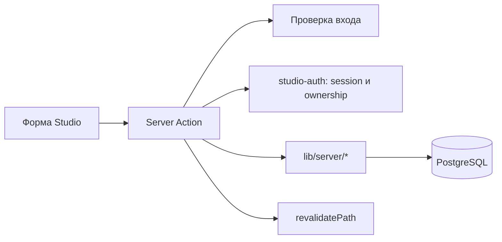

# Studio

Проверено по [коммиту](README.md). **Факт:** [`app/studio/layout.tsx`](../../app/studio/layout.tsx) проверяет сессию и строит общий UI. Страницы в [`app/studio/`](../../app/studio/) управляют релизами, изданиями, главами, персонажами, сериями, местами, играми и новостями. Мутации проходят через [`lib/actions/studio.ts`](../../lib/actions/studio.ts) и соседние `studio-*` actions; они используют схемы [`lib/schemas/`](../../lib/schemas/) и репозитории [`lib/server/`](../../lib/server/).

**Факт:** [`/studio`](../../app/studio/page.tsx) получает релизы через `getMyReleasesWithEditions`; администратор видит все, остальные — свои. Его число «Просмотров» суммирует `releases.view_count`. Причина недостоверности текущего значения описана в [analytics.md](analytics.md). Для доступа к релизу/изданию/главе применяются `require*Ownership()` из [`studio-auth.ts`](../../lib/server/studio-auth.ts). **План:** при расширении Studio сохранять проверку в каждой мутации; одного `proxy.ts` недостаточно.
