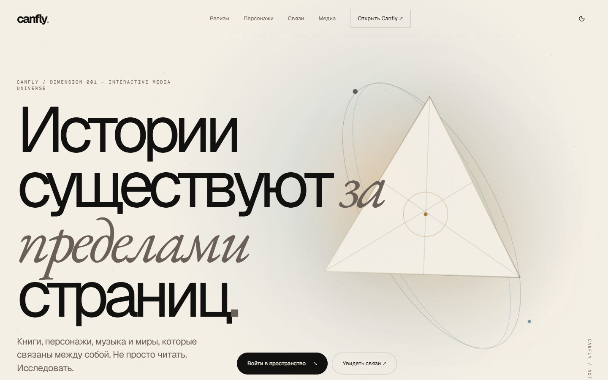
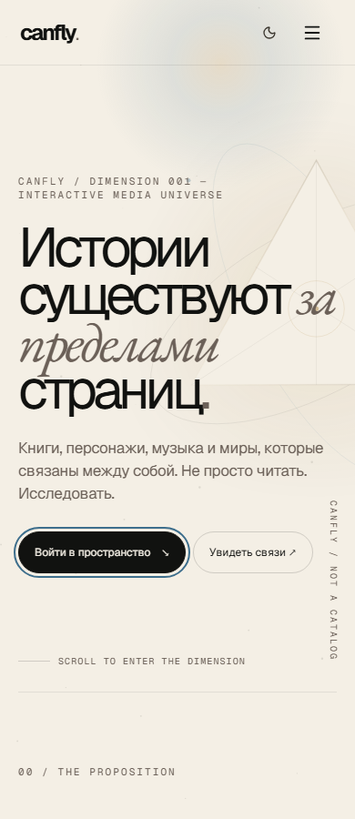
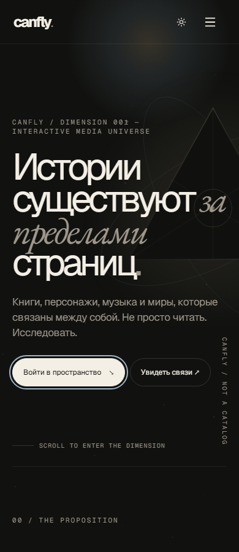

# Экспериментальная главная `/v2` — описание PR

**Заголовок PR:** `feat(v2): экспериментальная художественная главная`

**Ветка:** `feat/art-home-v2` → `main`. Слияние и production-деплой в эту задачу не входят.

## Пользовательский эффект

Отдельная художественная главная превращает релизы, персонажей и их связи в медиа-вселенную: The Media Dimension, «Крой по душе», Соня / Варя Сёмина / Мира Сент, интерактивный граф и `ocean028` в форматах аудио и книги. Текущая главная `/` остаётся прежней.

- Текст, обложки, форматы и связи приходят из существующих репозиториев БД, а не из демонстрационных карточек.
- Draft/archived-релизы исключены; переходы в издания разрешены только через `canOpenEdition`, предложения чата — через `resolveCharacterChatAvailability`.
- Две темы используют `cf-*`, `next-themes` и существующий `ThemeToggle`.
- Граф выбирается мышью, касанием и клавиатурой; Escape закрывает описание и возвращает фокус. Постоянная текстовая схема доступна и без JavaScript.
- «Аудио/Книга» меняет художественную визуализацию, не изображая работающий плеер. Настоящее воспроизведение открывается в доступном издании.
- Интерактивные сцены загружаются при приближении к экрану, сохраняя серверный текст и ссылки. Canvas учитывает DPR/resize, отменяет невидимые кадры и очищает обработчики. Системное уменьшение движения отключает анимации.

## Границы изменения

- `app/page.tsx`, существующие маршруты, общая навигация, Proxy, sitemap и CSP не менялись.
- `/v2` не добавлен в основную навигацию и закрыт `noindex, nofollow`. ISR: 60 секунд.
- Миграций, новых переменных окружения и зависимостей приложения нет. Production-данные не изменялись.
- Исходный `public/canfly-art-home.html` остаётся локальным референсом и не входит в коммит.

## Проверка

```bash
pnpm dev
# открыть http://localhost:3000/v2
pnpm exec playwright test -c playwright.v2.config.ts e2e/v2.spec.ts
pnpm lint
pnpm build
```

`playwright.v2.config.ts` отключает общие `globalSetup`/`globalTeardown`: проверки не создают тестового администратора и не выполняют мутаций БД. Нужны настроенная БД приложения и Chromium (`pnpm exec playwright install chromium`). E2E сверяет ссылки с текущими данными только через серверные репозитории.

Набор покрывает 360/390/768/1440px в обеих темах, читаемость CTA, отсутствие горизонтального скролла и обрезанных действий, граф, меню, переключение форм, DPR 2, остановку canvas, reduced-motion, SSR без JavaScript, metadata и изоляцию `/`.

### Результаты проверки · 10 ноября 2026

- `pnpm lint` проходил успешно. Повторный прогон не требуется для диагностики проблемы БД.
- В живом `next dev` проверены серверные/клиентские границы; `/_next/mcp` сообщал ноль compilation/runtime issues после свежего входа на `/v2`.
- В E2E прошли обе темы на четырёх ширинах, граф и клавиатура, переключение медиа, reduced-motion, no-JS, остановка/возобновление canvas и DPR 2. Меню и metadata/отбор контента также проходили в отдельных прогонах.
- В последнем прогоне сравнение размера `43.99997px` с CSS-минимумом `44px` оказалось ложным падением из-за округления DOMRect. Проверка округляет до тысячной пикселя; реальные CSS-минимумы не уменьшены.
- **Внешний блокер:** последняя `pnpm build` успешно скомпилировала код и проверила TypeScript, но не завершила prerender из-за таймаута PostgreSQL на существующей `/` (`components/home-news-section.tsx`) и при перечислении персонажей. Последний общий E2E был прерван; DB-зависимые проверки также получали таймауты. Полностью зелёный финальный прогон не заявляется — его нужно завершить при стабильном доступе к БД.

## Скриншоты

Desktop · 1440px · светлая тема:



| Mobile · light | Mobile · dark |
| --- | --- |
|  |  |

Скриншоты фиксируют работающий интерфейс, а не исходный HTML-прототип. Перед открытием доступа поисковым роботам и заменой `/` требуется отдельное продуктовое решение.
